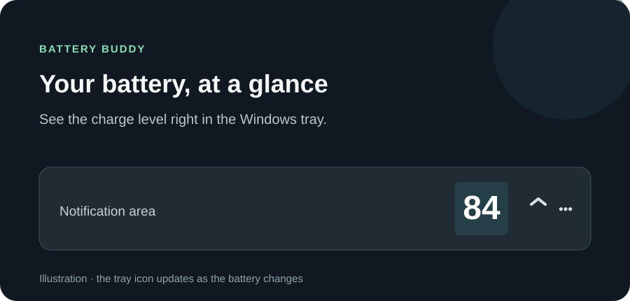
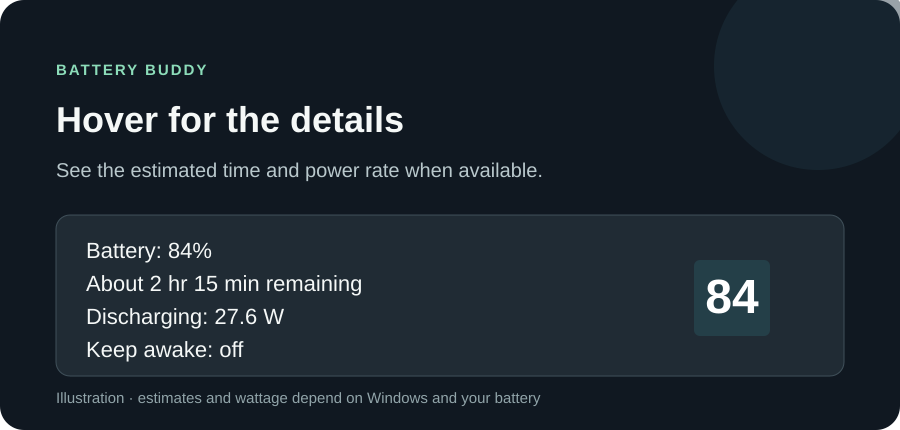
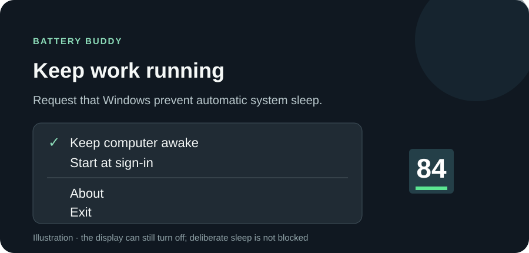

# Battery Buddy

A small native Win32 tray app for Windows that shows your battery percentage and helps keep your computer awake during long-running work. It is written in C++ and does not require .NET.

## At a glance

These illustrations show how Battery Buddy appears in the notification area and what its controls do. Battery values are examples.







## Download and use

Download [BatteryBuddy-Windows-x64.zip](https://github.com/ilantwig/battery-buddy-windows/releases/latest), extract it, and run `BatteryBuddy.exe`. Windows 10 or 11 x64 is required. The unsigned build may prompt an unknown publisher warning.

The notification-area icon shows your battery percentage. Hover over it for Windows' battery-time estimate, power status, and the charging or discharging rate in watts when the battery reports it. Readings refresh every five seconds and on power changes. The time estimate and power rate depend on your hardware and Windows and may be unavailable. The icon may appear behind the taskbar's hidden-icons arrow.

Right-click the icon to toggle **Keep computer awake**. A green bar appears on the icon while it is enabled. This requests that Windows prevent automatic system sleep while Battery Buddy is running; the display can still turn off. It does not prevent deliberate sleep, lid-close actions, shutdown, restart, or a drained battery. The setting starts off each time the app launches; turn it off or exit the app to release the request.

Choose **Start at sign-in** in the tray menu to run automatically for your Windows account. It is off by default. To remove Battery Buddy, turn off **Start at sign-in**, choose **Exit**, and remove its folder.

## Build and test

In PowerShell on Windows x64:

```powershell
./scripts/setup-toolchain.ps1
./build.ps1
./test.ps1
```

The setup script downloads a pinned LLVM-MinGW release and checks its SHA-256 hash. The build is written to `dist/BatteryBuddy.exe`. To use an existing LLVM-MinGW compiler, pass its path to either script with `-Compiler`.

## License

MIT. See [LICENSE.txt](LICENSE.txt) and [third-party notices](THIRD_PARTY_NOTICES.md).


